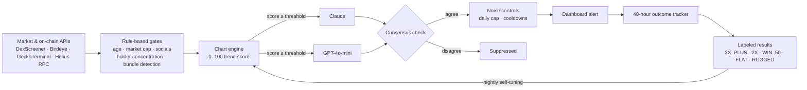

# Real-Time AI Analysis Platform

An autonomous, multi-model AI system that watches a fast-moving market (Solana tokens) 24/7, scores what it finds, sends only high-confidence alerts, and grades its own calls against real outcomes.

> **About this repo:** This is a showcase of the system's design, evaluation approach and results. The production source code (data connectors, scoring weights, and anything that touches funds) is kept private for security reasons.

<!-- Add screenshots to a /docs folder: dashboard, an alert card, the outcome scoreboard -->

---

## What it does

1. **Collects** live market, chart and on-chain data from several external APIs.
2. **Filters** out obvious junk with rule-based gates (age, market cap, social presence, holder concentration, coordinated-wallet checks).
3. **Scores** chart structure on a 0–100 scale. Only candidates that pass a minimum score go on to the AI step, which keeps API costs down.
4. **Asks two models.** Claude and GPT-4o-mini each return structured JSON scores for risk, momentum and timing. If they disagree, the result is suppressed.
5. **Alerts** through a cross-platform dashboard app (it originally used a Telegram message thread).
6. **Grades itself.** Every alert is tracked for 48 hours, labeled by what actually happened, and fed back into tuning.

## Architecture

## Key components

| Component | What it does |
|---|---|
| **Chart engine** | Scores candle data on EMA alignment, higher-lows structure, position in the 72-hour range and volume slope, with guards against chasing overextended moves |
| **Multi-model consensus** | Claude and GPT-4o-mini score each candidate separately. Any disagreement vetoes the alert, which cuts false positives |
| **On-chain ownership layer** | Measures real top-10 holder concentration, leaving out liquidity-pool and burn addresses |
| **Bundle detection** | Flags clusters of wallets funded from the same source among top holders (a common sign of coordinated or manipulated launches) |
| **Holder velocity & sustain tracking** | Tracks wallet growth as a sign of real community traction, and separates moves you could actually trade from brief spikes |
| **Outcome tracker** | Records each alert's entry fingerprint and peak price over 48 hours, then assigns an outcome label |
| **Noise controls** | Elite-tier-only alerts, a daily alert cap, and namespaced cooldowns so one blocked signal can't silently suppress a later, better one |

## Evaluation & results

The system measures its own accuracy instead of assuming it:

- After one month of live data, **27% of alerts reached 3x with zero rugs.**
- The same data showed **5 confirmed winners (including a 4x and a 7x) that never alerted.** The cause was daily-cap collisions and silent cooldown blocks, and fixing it became the next priority.
- Outcome data showed the short-term "pump" strategy had higher peaks but unreliable spikes. That led to a redesign around a trend-based approach targeting multi-day holds.

## Lessons learned

- **You can't improve what you don't measure.** The first versions had no outcome tracking, so nobody knew how good the alerts were. Adding labeled outcomes changed every decision after that.
- **Silent failures are the worst failures.** An audit found four bugs that kept the learning system from ever working: a winner condition that could never be met, eviction logic that discarded trade history, rug losses that never showed up in win rates, and a self-tuning job that crashed without reporting it. All four were fixed, and errors are now surfaced instead of swallowed.
- **Missed positives matter as much as false positives.** Tuning only for precision hid the best opportunities.

## Tech stack

Python · Claude API · OpenAI API (GPT-4o-mini) · REST APIs (DexScreener, Birdeye, GeckoTerminal) · Helius RPC · Railway (24/7 cloud deployment) · Telegram Bot API → cross-platform dashboard UI

## How it was built

Built using AI-assisted development with Claude Code, from first prototype through 80+ tested iterations (March–November 2026). I directed the architecture, defined the evaluation metrics, reviewed live outcome data to set priorities, and handled deployment, configuration and debugging.

---

**Samuel Aguilar** · [GitHub](https://github.com/sammya130-dev)
